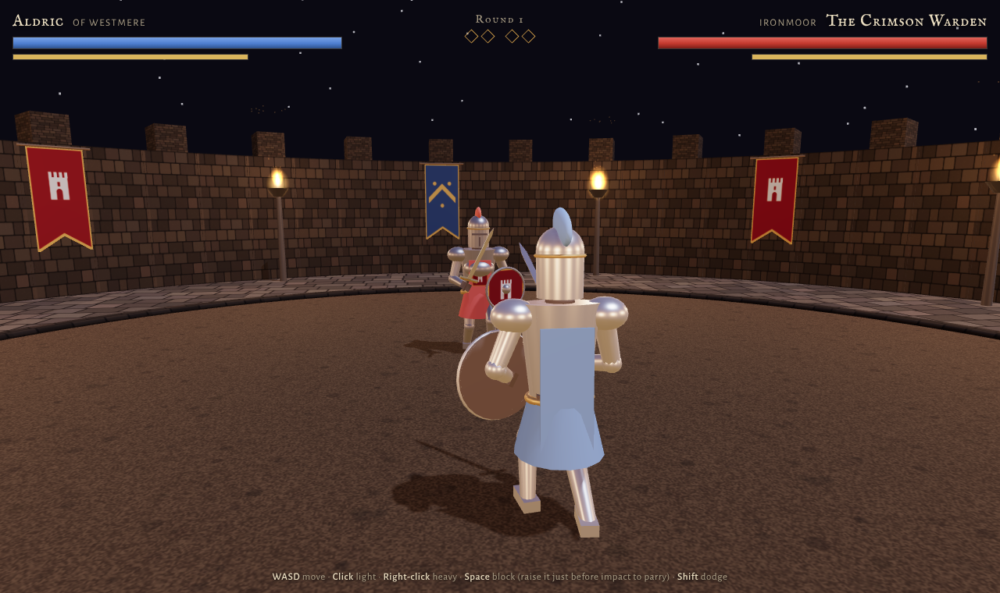

# Medieval Duel Bench

### Can a new model build a sword fight that's actually fun?

One prompt. No supplied assets. A playable 3D duel in a single HTML file.

**[Play Ironmoor Duel in your browser →](https://bitofastickler.github.io/medieval-duel-bench/)** · **[What it tests](#why-a-duel)** · **[Score your own model](#score-your-own-model)** · **[Read the prompt](#the-prompt)**

**Built by Claude (Anthropic) · Runs in any desktop browser · No install, accounts, or API keys**

---

## What this is

A fun, experimental benchmark for new models. Give a model the prompt below and see whether it can produce a 3D melee game that runs on the first try *and* feels good to play.

This repo holds the first entry: **Ironmoor Duel**, a Claude output. Take the same prompt to the next model you want to size up, play the two builds side by side, and the differences jump out fast.

## Ironmoor Duel

The Crimson Warden has held the old ring at Ironmoor for eleven winters. Best of three rounds. Watch his wind-up, raise your shield on the strike to parry, and make every missed swing cost him.

| | |
|:--|:--|
| **Engine** | Three.js r128 from a CDN, one `index.html`, about 1,000 lines |
| **Assets** | None. Knights, arena, banners, and heraldry are built from primitives and canvas drawings; sound is synthesized live |
| **Combat** | Light cuts that chain, overhead blows that can't be flinched, timed parries, feints, dodges with invulnerability frames, guard breaks, sword-on-sword clashes |
| **Hit detection** | Traced from the real blade position each physics step, not a distance check |
| **Opponent** | Reaction-delayed AI that presses, baits, circles, punishes whiffs, interrupts slow attacks, and feints. Three difficulty levels |
| **Game feel** | Hit-stop, camera shake, sparks, blade trails, parry slow-motion, a toppling death with a sword that clatters away |

### Controls

| Input | Action |
|:--|:--|
| `W` `A` `S` `D` | Advance, retreat, circle (you stay locked on) |
| Left click / `J` | Light cut. Fast, and chains into a second cut |
| Right click / `K` | Overhead blow. Slow, heavy, keeps going if you're hit |
| `Space` / `L` | Block. Raise it at the last instant to **parry**. During your own overhead wind-up, it **feints** |
| `Shift` | Dodge in the direction you're moving |

Phones get an on-screen stick and buttons, but it's built for keyboard and mouse.

## Why a duel makes a good benchmark

A sword fight packs a lot of hard things into one prompt, and you judge it by playing it, not by reading a score.

| What you're really testing | Where it breaks |
|:--|:--|
| 3D math | Arms detach, swords point backwards, models fall through the floor |
| Procedural animation without assets | Stiff, floaty, or physically impossible swings |
| Real hit detection | You get hit from behind, or a sword passes through someone with no effect |
| Game AI | The opponent walks at you and swings forever |
| Game feel | Hits land with no weight. No pause, no shake, no sound |
| Long-file coherence | 1,000+ lines that have to work together on the first run |
| Taking feedback | Ask it to "make parries feel weightier" and see if it makes a targeted fix or rewrites everything |

## Score your own model

Give each build ten minutes of play, then mark each row 0 to 2.

| Check | 0 | 1 | 2 |
|:--|:--|:--|:--|
| Runs first try | Broken | Runs after a fix | Runs clean |
| Characters hold together | Limbs fly apart | Occasional glitches | Solid through every move |
| Blade-based hit detection | Distance check | Partly faked | Dodging a swing actually works |
| Parry and block | Missing | Works, no reward | Timing matters and pays off |
| Opponent behavior | Walks and swings | Some variety | Baits, punishes, adapts |
| Game feel | Nothing | Some effects | Impacts feel heavy |
| Rounds and restart | Missing | Partial | Full loop, clean restart |
| Is it fun? | No | For a minute | You want one more round |

## The prompt

The model suggested the duel itself when asked for a fun way to test new models. It then wrote this spec, and built the game from it in the same session after a one-word "Sure! Let's try it":

> Build a single-file HTML 3D medieval sword duel using Three.js (from a CDN). No external assets: build all models from primitives and animate them procedurally.
> - Player knight vs. AI knight in a torch-lit arena with dynamic shadows
> - Controls: WASD to move, mouse to aim, left click for a light attack, right click for a heavy attack, Space to block, Shift to dodge
> - Stamina system: attacks, blocks and dodges cost stamina, and a well-timed block **parries** and staggers the opponent
> - Hit detection based on where the sword actually is, not a distance check
> - The AI reads your stance, baits you, and punishes whiffed heavies
> - Game feel: hit-stop, camera shake, sparks on clashes, a ragdoll-ish death
> - Health and stamina bars, a round system, and a restart screen

To compare fairly, paste that block into a fresh chat with the model you're testing and ask for one file.

## Provenance and limits

| | |
|:--|:--|
| Model | Claude (Anthropic) |
| Where it ran | Claude Code, cloud session |
| Turns to build | One, from the prompt above |
| Human edits to the game | None |
| Model's own fixes | One. Its headless smoke test showed the hidden end-screen overlay was blocking clicks, so it added a one-line CSS rule before publishing |

**This is a single run, not a controlled benchmark.** I don't have token counts, generation times, or repeated trials. The model wrote its own spec, so another model working from that spec is playing on Claude's home turf a little. The game is preserved as delivered.

## Run it locally

Download or clone the repo, then open `index.html` in Chrome, Edge, or Firefox. It loads Three.js and two Google Fonts from the web, so the first load needs an internet connection.

---

**The interesting part isn't who wins the duel. It's how each model swings.**

An independent experiment curated by [bitofastickler](https://github.com/bitofastickler). Not an official Anthropic benchmark.

