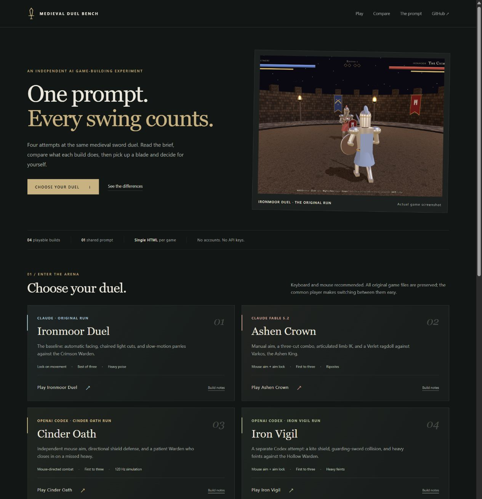

# Medieval Duel Bench

**One prompt. Four playable builds. See what the models actually made.**

[**Play & compare →**](https://bitofastickler.github.io/medieval-duel-bench/) · [Shared prompt](#the-prompt) · [Build notes & screenshots](docs/BUILD_NOTES.md) · [Scoring rubric](docs/BUILD_NOTES.md#score-your-own-model)

[](https://bitofastickler.github.io/medieval-duel-bench/)

An independent experiment by [bitofastickler](https://github.com/bitofastickler). Each entry is a standalone HTML sword duel with procedural models, animation, combat, and sound. Use a desktop browser, keyboard, and mouse. No accounts or API keys.

## Choose a build

| Build | Model / run | What differs | Recorded validation | Play |
|:--|:--|:--|:--|:--|
| **Ironmoor Duel** | Claude · original | Lock-on movement; chained light cuts; heavy poise; parry slow-motion | Reported headless smoke test; one overlay fix | [Play](https://bitofastickler.github.io/medieval-duel-bench/play.html?game=ironmoor) |
| **Ashen Crown** | Claude Fable 5.2 | Mouse aim + optional lock-on; three-cut combo; two-bone IK; Verlet ragdoll | Reported headless checks; two fixes | [Play](https://bitofastickler.github.io/medieval-duel-bench/play.html?game=ashen-crown) |
| **Cinder Oath** | OpenAI Codex · separate run | Mouse aim; directional round shield; 120 Hz blade sweeps; sustained baiting | 27 in-browser combat/state checks; 60-second simulation; browser interaction checks | [Play](https://bitofastickler.github.io/medieval-duel-bench/play.html?game=cinder-oath) |
| **Iron Vigil** | OpenAI Codex · separate run | Mouse aim + optional lock-on; kite shield and guarding-sword collision; heavy feints | 18 simulation checks using real Three.js and a stubbed renderer/DOM | [Play](https://bitofastickler.github.io/medieval-duel-bench/play.html?game=iron-vigil) |

**Integration check (13 November 2026):** all four builds started a round in the shared browser player; build switching and the responsive homepage were checked. This confirms launch and navigation, not comparative gameplay performance.

The site’s player lets you switch builds and return to the comparison without losing your place in the repo. Direct standalone versions remain available at [Ironmoor](ironmoor/index.html), [Ashen Crown](fable-5.2/index.html), [Cinder Oath](codex/index.html), and [Iron Vigil](iron-vigil/index.html).

## What the results tell us

**The builds differ in implemented behavior and validation coverage. There is no published head-to-head gameplay ranking yet.** The test counts above come from different suites, so 27 versus 18 is not a quality score. Comparable FPS, latency, generation time, cost, token usage, and human play scores have not been recorded.

- **Ironmoor:** the original baseline, with automatic facing and chained cuts.
- **Ashen Crown:** adds optional manual aim, a three-hit combo, articulated IK, and a Verlet ragdoll.
- **Cinder Oath:** emphasizes independent mouse aim, directional shield defense, and reaction-delayed whiff punishment.
- **Iron Vigil:** another Codex run with an exact kite-shield collision shape, a guarding sword, and heavy feints.

Play each for ten minutes under the same conditions, then use the [eight-part 0–2 rubric](docs/BUILD_NOTES.md#score-your-own-model). The [complete notes](docs/BUILD_NOTES.md) retain the original claims, fixes, screenshots, controls, and provenance so those observations can be checked.

## The prompt

Give this unchanged prompt to each model in a fresh session:

```text
Build a single-file HTML 3D medieval sword duel using Three.js (from a CDN). No external assets: build all models from primitives and animate them procedurally.
- Player knight vs. AI knight in a torch-lit arena with dynamic shadows
- Controls: WASD to move, mouse to aim, left click for a light attack, right click for a heavy attack, Space to block, Shift to dodge
- Stamina system: attacks, blocks and dodges cost stamina, and a well-timed block **parries** and staggers the opponent
- Hit detection based on where the sword actually is, not a distance check
- The AI reads your stance, baits you, and punishes whiffed heavies
- Game feel: hit-stop, camera shake, sparks on clashes, a ragdoll-ish death
- Health and stamina bars, a round system, and a restart screen
```

The first Claude run proposed this prompt and implemented it after “Sure! Let’s try it.” Later entries reuse that brief. That origin is part of the experiment’s limitations; it is not a controlled model ranking. Two separate Codex runs produced Iron Vigil and Cinder Oath. Exact underlying Codex model versions were not recorded.

## Run locally

Open `index.html` to browse the comparison or open any game’s `index.html` directly. Alternatively, run `python -m http.server 8000` in the repository and visit `http://localhost:8000`.

Games load Three.js from CDNs. The original Ironmoor build also loads Google Fonts; Ashen Crown optionally loads a bloom addon. No game models, textures, or audio files are downloaded. All original game files and existing screenshots are preserved unchanged.

## Repository layout

| Path | Purpose |
|:--|:--|
| `index.html` | Shared prompt, comparison, evidence, and play links |
| `play.html` | Common player with build switching and fullscreen |
| `ironmoor/index.html` | Original Claude build, preserved byte-for-byte |
| `fable-5.2/index.html` | Ashen Crown, preserved byte-for-byte |
| `codex/index.html` | Cinder Oath; existing published URL retained |
| `iron-vigil/index.html` | Iron Vigil; separate path to resolve the Codex-file conflict |
| `docs/BUILD_NOTES.md` | Full benchmark history, controls, fixes, screenshots, and rubric |

Future entries should use a unique build-name directory rather than a shared model directory. Add their model/run label, play link, and evidence without replacing previous entries.

Not an official Anthropic or OpenAI benchmark.
