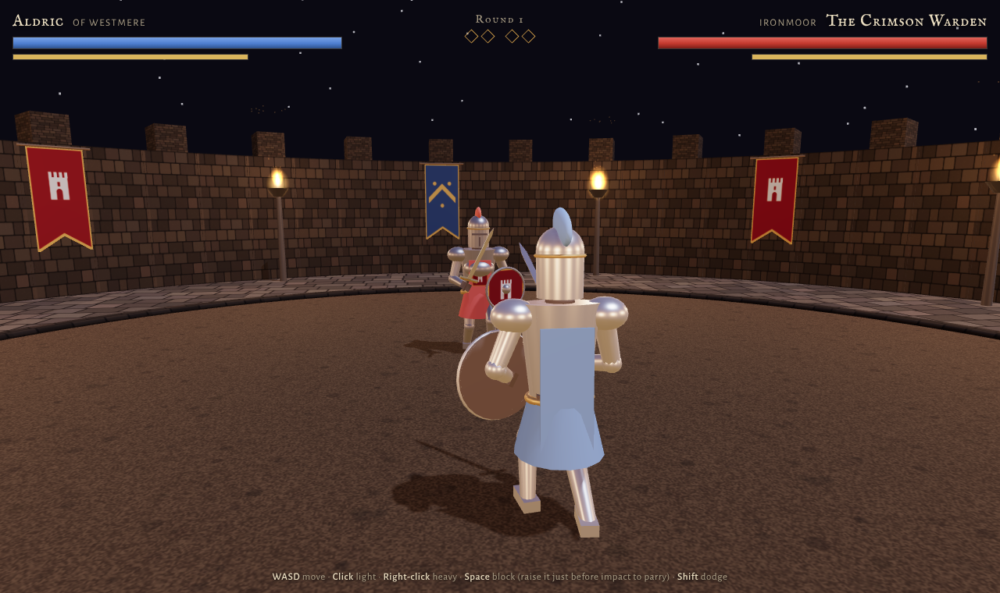
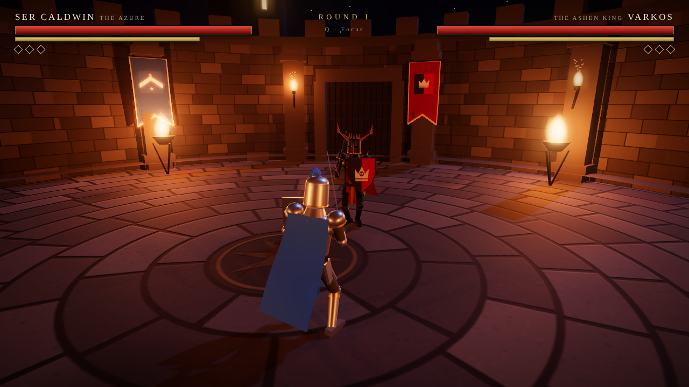

# Complete benchmark notes

[Back to the overview](../README.md) · [Play and compare all builds](https://bitofastickler.github.io/medieval-duel-bench/)

These are the detailed descriptions and original validation notes from the submitted builds. They preserve the project’s provenance, screenshots, controls, known fixes, evaluation rubric, and limitations. Test statements describe each build’s own checks, not a common comparative test suite. Iron Vigil and Cinder Oath are distinct Codex runs; exact underlying Codex model versions were not recorded.

## Model attribution and submission history

| Build | Model attribution | Source |
|:--|:--|:--|
| **Ironmoor Duel** | **Claude Opus 5.5** — confirmed by the repository owner and original commit | [Original commit](https://github.com/bitofastickler/medieval-duel-bench/commit/ef51d43ba2967295d5e42762c79a3cb5748cdf85) |
| **Ashen Crown** | **Claude Fable 5.2** — recorded in the original commit | [Original commit](https://github.com/bitofastickler/medieval-duel-bench/commit/149c523b2cc1e8f5037fe684219e5beb575281ea) |
| **Iron Vigil** | **OpenAI — exact model unconfirmed**; submitted through Codex | [Original commit](https://github.com/bitofastickler/medieval-duel-bench/commit/bb5dc8a3fe42093fbbb9ac3ac8d84358b43f352d) · [PR #2](https://github.com/bitofastickler/medieval-duel-bench/pull/2) |
| **Cinder Oath** | **OpenAI — exact model unconfirmed**; submitted through Codex | [Original commit](https://github.com/bitofastickler/medieval-duel-bench/commit/74a2cfaa1c7cee4744080b138118fa331e2ac934) · [PR #3](https://github.com/bitofastickler/medieval-duel-bench/pull/3) |

**Why there are two OpenAI builds:** Iron Vigil was committed on 13 November 2026 at 22:22 UTC and submitted in PR #2. Cinder Oath was subsequently committed at 23:02 UTC and submitted in PR #3. Both used `codex/index.html`, which caused the merge conflict. The integration preserved Cinder Oath at that existing URL and moved Iron Vigil unchanged to `iron-vigil/index.html`.

The repository owner reports starting and aborting an earlier **SOL** attempt. The available commit and PR records do not establish whether that attempt produced Iron Vigil. Neither OpenAI submission includes an exact model ID, and “Codex” identifies the development workflow rather than a model. Four saved builds therefore do not establish four distinct models or four completed, controlled benchmark runs.

## Shared integration review · 13 November 2026

All four builds started a round in the shared browser player. Build switching, the prompt-copy confirmation, and the responsive homepage were checked. Each game file matches its submitted Git blob exactly. These checks establish launch and navigation; they do not replace the original validation notes below or measure relative gameplay quality.

# Medieval Duel Bench

### Can a new model build a sword fight that's actually fun?

One prompt. No supplied assets. A playable 3D duel in a single HTML file.

**[Choose from all four duels →](https://bitofastickler.github.io/medieval-duel-bench/)** · **[Play Ironmoor Duel](https://bitofastickler.github.io/medieval-duel-bench/ironmoor/)** · **[What it tests](#why-a-duel)** · **[Score your own model](#score-your-own-model)** · **[Read the prompt](#the-prompt)**

**First entry built by Claude Opus 5.5 (Anthropic) · Runs in any desktop browser · No install, accounts, or API keys**

---

## What this is

A fun, experimental benchmark for new models. Give a model the prompt below and see whether it can produce a 3D melee game that runs on the first try *and* feels good to play.

This repo holds the first entry: **Ironmoor Duel**, a Claude Opus 5.5 output. Take the same prompt to the next model you want to size up, play the two builds side by side, and the differences jump out fast.

The [GitHub Pages home page](https://bitofastickler.github.io/medieval-duel-bench/) is a launcher for all four games. Ironmoor's original HTML is preserved byte-for-byte at `ironmoor/index.html`; the Fable build and all existing screenshots are unchanged. The descriptions, prompt, provenance, and scoring rubric below are retained.

## Ironmoor Duel

The Crimson Warden has held the old ring at Ironmoor for eleven winters. Best of three rounds. Watch his wind-up, raise your shield on the strike to parry, and make every missed swing cost him.

| | |
|:--|:--|
| **Engine** | Three.js r128 from a CDN, one `ironmoor/index.html`, about 1,000 lines |
| **Assets** | None. Knights, arena, banners, and heraldry are built from primitives and canvas drawings; sound is synthesized live |
| **Combat** | Light cuts that chain, overhead blows that can't be flinched, timed parries, feints, dodges with invulnerability frames, guard breaks, sword-on-sword clashes |
| **Hit detection** | Traced from the real blade position each physics step, not a distance check |
| **Opponent** | Reaction-delayed AI that presses, baits, circles, punishes whiffs, interrupts slow attacks, and feints. Three difficulty levels |
| **Game feel** | Hit-stop, camera shake, sparks, blade trails, parry slow-motion, a toppling death with a sword that clatters away |

### Controls

| Input | Action |
|:--|:--|
| `W` `A` `S` `D` | Advance, retreat, circle (you stay locked on) |
| Left click / `J` | Light cut. Fast, and chains into a second cut |
| Right click / `K` | Overhead blow. Slow, heavy, keeps going if you're hit |
| `Space` / `L` | Block. Raise it at the last instant to **parry**. During your own overhead wind-up, it **feints** |
| `Shift` | Dodge in the direction you're moving |

Phones get an on-screen stick and buttons, but it's built for keyboard and mouse.

## Entries

Each model gets the same prompt and its own file, so the builds can be played side by side.

| Entry | Model | File | Play |
|:--|:--|:--|:--|
| **Ironmoor Duel** | Claude Opus 5.5 (first entry) | [`ironmoor/index.html`](../ironmoor/index.html) | [Play](https://bitofastickler.github.io/medieval-duel-bench/ironmoor/) |
| **Ashen Crown** | Claude Fable 5.2 | [`fable-5.2/index.html`](../fable-5.2/index.html) | [Play](https://bitofastickler.github.io/medieval-duel-bench/fable-5.2/) |
| **Iron Vigil** | OpenAI — exact model unconfirmed (Codex workflow) | [`iron-vigil/index.html`](../iron-vigil/index.html) | [Play](https://bitofastickler.github.io/medieval-duel-bench/iron-vigil/) |
| **Cinder Oath** | OpenAI — exact model unconfirmed (Codex workflow) | [`codex/index.html`](../codex/index.html) | [Play](https://bitofastickler.github.io/medieval-duel-bench/codex/) |

### Ashen Crown (Fable 5.2)

First to three rounds against Varkos, the Ashen King. Mouse aims your knight, so a swing only lands if the blade is actually pointed at him.

| | |
|:--|:--|
| **Engine** | Three.js r160 as an ES module from a CDN, one `fable-5.2/index.html`. Bloom is loaded as an optional addon and the game runs without it |
| **Assets** | None. Knights, arena, banners and heraldry are primitives and canvas drawings; sound is synthesized live |
| **Animation** | Sword hand, shield hand and feet are driven by two-bone IK from keyframed targets, so limbs stay attached through every move |
| **Combat** | Three-cut light combo, heavy overhead with late-windup poise, feints, timed parries, guard breaks, ripostes, dodges with invulnerability frames, blade-on-blade clashes |
| **Hit detection** | The blade segment is swept between physics steps against capsules built from the live skeleton, and against the raised shield |
| **Opponent** | Reaction-delayed AI that tracks your habits (aggression, turtling, dodging), drops its guard to bait a swing, feints heavies, and punishes whiffs. Three difficulty levels |
| **Game feel** | Hit-stop, camera shake, FOV kick, sparks, blade trails, parry slow-motion, a verlet ragdoll death with a sword that tumbles free |

Controls are the ones in the prompt, plus `Q` to lock your facing onto the foe and `M` to mute. Tapping `Space` during a heavy windup feints.

Built in one turn from the prompt below, with no human edits. The model ran its own headless checks before publishing and made two fixes: a dodge speed curve that produced invalid positions on its last step, and an arena rim that had been built as a solid lid over the ring.

### Iron Vigil (OpenAI Codex)

First to three victories against the Hollow Warden in a torch-lit stone keep. One standalone HTML file, with all models built from geometry and animated procedurally. Three.js r160 from a CDN is the only network dependency; the interface uses system fonts and the game loads no external assets.

| | |
|:--|:--|
| **Combat** | Light cuts, heavy overheads, feints, stamina, guard breaks, dodges, 180 ms parries, and enforced recovery after a missed heavy |
| **Hit detection** | Swept blade segments against capsules following the live rig, the exact kite shield, and the guarding sword |
| **Opponent** | Reaction-delayed AI reads your stance, baits attacks, and closes to punish whiffed heavies |
| **Game feel** | Dynamic torch shadows, hit-stop, camera shake, clash sparks, blade trails, synthesized audio, and a procedural toppling death |

Controls follow the prompt, plus `Q` to toggle aim lock, `J` / `K` for light / heavy attacks, `M` to mute, and `Esc` to pause. Press `Space` during an early heavy wind-up to feint.

Validation included simulation checks for combat and round transitions. Browser playtesting remains unverified because the preview environment failed to start.

### Cinder Oath (Codex)

A duel against the Cinder Warden in a ruined, torch-lit monastery. First to three rounds, with three difficulty levels. The mouse aims at a point on the arena floor; WASD moves independently of facing.

| | |
|:--|:--|
| **Engine** | Three.js r160 from a pinned CDN with a second CDN fallback. One `codex/index.html`, approximately 53 KB |
| **Assets** | None. Primitive geometry, procedural fire halos, articulated knights, animated cloth, particles, and synthesized Web Audio. No image, font, model, or audio downloads |
| **Combat** | Light cuts, heavy overheads, directional shield blocks, 180 ms parries, guard breaks, stamina recovery, and directional dodges |
| **Hit detection** | 120 Hz simulation. The rendered blade's world-space segment is swept against live body capsules, oriented shield discs, and opposing active blades. Each attack can connect only once |
| **Opponent** | Delayed observation of visible state, circling, sustained baiting, heavy feints, retreat to recover stamina, and a committed punish after an observed missed heavy |
| **Game feel** | Hit-stop, camera shake, blade trails, clash sparks, procedural sound, and a damped articulated death pose |
| **Round loop** | First to three, round announcements, victory/defeat statistics, restart, difficulty selection, pause, and automatic pause when focus is lost |

Controls follow the prompt. `J` / `K` also trigger light / heavy attacks; `Esc` pauses and `M` mutes. The game is designed for keyboard and mouse.

Built from the benchmark prompt in one conversation, with agent-led testing and refinements. Validation included 27 in-browser combat checks, a 60-second simulation, and browser checks of the round loop, controls, pause/resume, and restart. This is functional verification, not a playability score or a substitute for human playtesting.

Open `codex/index.html` directly in a desktop browser, or serve the repository locally. Internet access is needed to load Three.js. All four entries are available from the [GitHub Pages launcher](https://bitofastickler.github.io/medieval-duel-bench/).

## Why a duel makes a good benchmark

A sword fight packs a lot of hard things into one prompt, and you judge it by playing it, not by reading a score.

| What you're really testing | Where it breaks |
|:--|:--|
| 3D math | Arms detach, swords point backwards, models fall through the floor |
| Procedural animation without assets | Stiff, floaty, or physically impossible swings |
| Real hit detection | You get hit from behind, or a sword passes through someone with no effect |
| Game AI | The opponent walks at you and swings forever |
| Game feel | Hits land with no weight. No pause, no shake, no sound |
| Long-file coherence | 1,000+ lines that have to work together on the first run |
| Taking feedback | Ask it to "make parries feel weightier" and see if it makes a targeted fix or rewrites everything |

## Score your own model

Give each build ten minutes of play, then mark each row 0 to 2.

| Check | 0 | 1 | 2 |
|:--|:--|:--|:--|
| Runs first try | Broken | Runs after a fix | Runs clean |
| Characters hold together | Limbs fly apart | Occasional glitches | Solid through every move |
| Blade-based hit detection | Distance check | Partly faked | Dodging a swing actually works |
| Parry and block | Missing | Works, no reward | Timing matters and pays off |
| Opponent behavior | Walks and swings | Some variety | Baits, punishes, adapts |
| Game feel | Nothing | Some effects | Impacts feel heavy |
| Rounds and restart | Missing | Partial | Full loop, clean restart |
| Is it fun? | No | For a minute | You want one more round |

## The prompt

The model suggested the duel itself when asked for a fun way to test new models. It then wrote this spec, and built the game from it in the same session after a one-word "Sure! Let's try it":

> Build a single-file HTML 3D medieval sword duel using Three.js (from a CDN). No external assets: build all models from primitives and animate them procedurally.
> - Player knight vs. AI knight in a torch-lit arena with dynamic shadows
> - Controls: WASD to move, mouse to aim, left click for a light attack, right click for a heavy attack, Space to block, Shift to dodge
> - Stamina system: attacks, blocks and dodges cost stamina, and a well-timed block **parries** and staggers the opponent
> - Hit detection based on where the sword actually is, not a distance check
> - The AI reads your stance, baits you, and punishes whiffed heavies
> - Game feel: hit-stop, camera shake, sparks on clashes, a ragdoll-ish death
> - Health and stamina bars, a round system, and a restart screen

To compare fairly, paste that block into a fresh chat with the model you're testing and ask for one file.

## Provenance and limits

| | |
|:--|:--|
| Model | Claude Opus 5.5 (Anthropic) |
| Where it ran | Claude Code, cloud session |
| Turns to build | One, from the prompt above |
| Human edits to the game | None |
| Model's own fixes | One. Its headless smoke test showed the hidden end-screen overlay was blocking clicks, so it added a one-line CSS rule before publishing |

**This is a single run, not a controlled benchmark.** I don't have token counts, generation times, or repeated trials. The model wrote its own spec, so another model working from that spec is playing on Claude's home turf a little. The game is preserved as delivered.

## Run it locally

Download or clone the repo, then open `index.html` in Chrome, Edge, or Firefox to choose a duel. You can also open `ironmoor/index.html`, `fable-5.2/index.html`, or `codex/index.html` directly. Each game loads Three.js from the web; the original Ironmoor build also loads two Google Fonts, so the first load needs an internet connection.

---

**The interesting part isn't who wins the duel. It's how each model swings.**

An independent experiment curated by [bitofastickler](https://github.com/bitofastickler). Not an official Anthropic benchmark.

